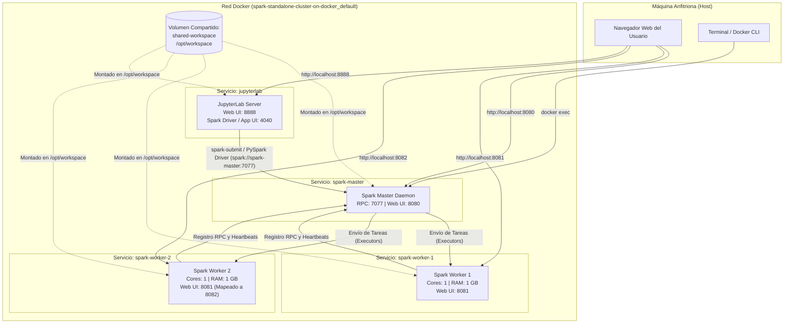

# LG14 - Investigación y Despliegue de un Repositorio Big Data con Docker

## Clúster Distribuido de Apache Spark con JupyterLab

---

## 1. Registro Obligatorio del Repositorio

* **Nombre de los estudiantes:** *[Completar con los nombres del grupo]*
* **Nombre del repositorio:** `spark-standalone-cluster-on-docker`
* **URL original:** [https://github.com/cluster-apps-on-docker/spark-standalone-cluster-on-docker](https://github.com/cluster-apps-on-docker/spark-standalone-cluster-on-docker)
* **Autor / Organización:** `cluster-apps-on-docker` (André Perez)
* **Descripción en una línea:** Clúster distribuido de Apache Spark en modo Standalone (1 Master + 2 Workers) con interfaz interactiva JupyterLab para procesamiento analítico de datos sobre Docker.

---

## 2. Información General del Proyecto

| Parámetro | Detalle |
| :--- | :--- |
| **Nombre del Proyecto** | Apache Spark Standalone Cluster on Docker |
| **Autor / Organización** | `cluster-apps-on-docker` / André Perez |
| **URL del Repositorio** | https://github.com/cluster-apps-on-docker/spark-standalone-cluster-on-docker |
| **Fecha de creación** | 3 de julio de 2020 |
| **Última actualización** | Octubre 2026 (Mantenido activamente) |
| **Número de estrellas (Stars)** | 510+ |
| **Número de forks** | 194+ |
| **Licencia** | MIT License |
| **Objetivo del proyecto** | Proveer un entorno distribuido reproducible de Apache Spark en modo Standalone con JupyterLab mediante Docker Compose, permitiendo ejecutar analítica distribuida y procesamiento de Big Data en Python (PySpark), Scala y R (SparkR). |

---

## 3. Tecnologías Utilizadas

* **Tecnología Big Data Principal:** **Apache Spark (v3.5.7)** – Motor de computación distribuida de alto rendimiento y baja latencia en memoria.
* **Orquestación de Contenedores:** **Docker** (Docker Engine 29.8+) y **Docker Compose** (v2.x / especificación v3.7+).
* **Sistema Operativo Base de las Imágenes:** Debian Linux (con OpenJDK / SapMachine 21 y Scala 2.12).
* **Almacenamiento Distribuido / Persistencia:** Docker Named Volume `hadoop-distributed-file-system` montado como espacio de trabajo compartido `/opt/workspace`.
* **Frameworks e Interfaces Adicionales:**
  * **JupyterLab (v4.4.10):** Entorno interactivo para desarrollo de notebooks analíticos.
  * **PySpark:** API de Python para Apache Spark.
  * **Spark Web UI:** Dashboards web nativos para monitoreo del clúster y ejecución de tareas.
* **Lenguajes Utilizados:** Python, Scala, R, Bash/Shell, Dockerfile.

---

## 4. Análisis de la Arquitectura

### 4.1 Inventario de Contenedores y Servicios

El entorno despliega un clúster de **4 contenedores**:

| Contenedor | Imagen Docker | Rol / Función | Puertos (Host:Contenedor) | Variables de Entorno Clave |
| :--- | :--- | :--- | :--- | :--- |
| `spark-master` | `andreper/spark-master:3.5.7` | Nodo maestro y coordinador del clúster. Gestiona recursos, calendariza tareas y monitorea workers. | `8080:8080` (Web UI)<br>`7077:7077` (RPC Master) | `SPARK_MASTER_PORT=7077`<br>`SPARK_MASTER_WEBUI_PORT=8080` |
| `spark-worker-1` | `andreper/spark-worker:3.5.7` | Nodo de procesamiento esclavo 1. Ejecuta tareas distribuidas asignadas por el master. | `8081:8081` (Worker Web UI) | `SPARK_WORKER_CORES=1`<br>`SPARK_WORKER_MEMORY=1g` |
| `spark-worker-2` | `andreper/spark-worker:3.5.7` | Nodo de procesamiento esclavo 2. Procesa particiones de datos en paralelo. | `8082:8081` (Worker Web UI) | `SPARK_WORKER_CORES=1`<br>`SPARK_WORKER_MEMORY=1g` |
| `jupyterlab` | `andreper/jupyterlab:4.4.10-spark-3.5.7` | Cliente interactivo. Permite a los analistas ejecutar notebooks conectados al clúster Spark. | `8888:8888` (JupyterLab UI)<br>`4040:4040` (Spark Application UI) | Entorno Python 3 con PySpark y kernels Scala/R |

### 4.2 Redes, Volúmenes y Dependencias

* **Red:** Red interna puente (*bridge*) creada automáticamente por Docker Compose (`spark-standalone-cluster-on-docker_default`), que permite resolución DNS por nombre de servicio (`spark-master`, `spark-worker-1`, etc.).
* **Volúmenes:** Volumen local `shared-workspace` (nombre interno: `hadoop-distributed-file-system`) montado en `/opt/workspace` en todos los contenedores para compartir datasets, scripts y artefactos de datos.
* **Dependencias:** Los contenedores `spark-worker-1` y `spark-worker-2` definen `depends_on: [spark-master]`, asegurando que el nodo coordinador esté listo antes de que los trabajadores intenten registrarse.

### 4.3 Diagrama de Arquitectura Real



---

## 5. Implementación Práctica y Despliegue

### Paso 1: Clonar el Repositorio
```bash
git clone https://github.com/cluster-apps-on-docker/spark-standalone-cluster-on-docker.git
```

### Paso 2: Ingresar al Directorio
```bash
cd spark-standalone-cluster-on-docker
```

### Paso 3: Identificar los Archivos Principales
```bash
ls -la
```
*Archivos identificados:* `docker-compose.yml`, `assets/`, `build/`, `docs/`, `scripts/`, `evidencias/`.

### Paso 4: Analizar el Archivo Docker Compose
```bash
cat docker-compose.yml
```
Define los 4 servicios descritos en la arquitectura, el volumen `shared-workspace` y la configuración de recursos (`SPARK_WORKER_CORES=1`, `SPARK_WORKER_MEMORY=1g`).

### Paso 5: Construir y Ejecutar el Clúster
```bash
docker compose up -d
```

### Paso 6: Verificar el Estado de los Contenedores
```bash
docker ps
```
**Resultado verificado:**
```text
CONTAINER ID   IMAGE                                    COMMAND                  STATUS          PORTS                                                                                      NAMES
549eff829a77   andreper/spark-worker:3.5.7              "/bin/sh -c 'bin/spa…"   Up 10 minutes   0.0.0.0:8082->8081/tcp, [::]:8082->8081/tcp                                                spark-worker-2
3a10ec982d2f   andreper/spark-worker:3.5.7              "/bin/sh -c 'bin/spa…"   Up 10 minutes   0.0.0.0:8081->8081/tcp, [::]:8081->8081/tcp                                                spark-worker-1
a46ad097818c   andreper/spark-master:3.5.7              "/bin/sh -c 'bin/spa…"   Up 10 minutes   0.0.0.0:7077->7077/tcp, [::]:7077->7077/tcp, 0.0.0.0:8080->8080/tcp, [::]:8080->8080/tcp   spark-master
8974f233b7ae   andreper/jupyterlab:4.4.10-spark-3.5.7   "/bin/sh -c 'jupyter…"   Up 10 minutes   0.0.0.0:4040->4040/tcp, [::]:4040->4040/tcp, 0.0.0.0:8888->8888/tcp, [::]:8888->8888/tcp   jupyterlab
```

---

## 6. Pruebas Funcionales Realizadas

### Prueba 1: Monitoreo y Verificación en la Web UI de Spark Master
* **URL:** `http://localhost:8080`
* **Verificación:**
  * Estado del clúster: **ALIVE**.
  * URL del master: `spark://spark-master:7077`.
  * **Alive Workers:** 2 trabajadores registrados (`worker-1` en `172.19.0.4` y `worker-2` en `172.19.0.5`).
  * **Cores:** 2 Cores asignados (1 por worker).
  * **Memoria Total:** 2048 MB (1024 MB por worker).

---

### Prueba 2: Cálculo Distribuido de Pi con `SparkPi`
Se envió un trabajo distribuido de cálculo de $\pi$ mediante aproximación de Monte Carlo con 10 particiones distribuidas entre los dos trabajadores del clúster:

```bash
docker exec spark-master /usr/bin/spark-3.5.7-bin-hadoop3/bin/spark-submit \
  --master spark://spark-master:7077 \
  --class org.apache.spark.examples.SparkPi \
  /usr/bin/spark-3.5.7-bin-hadoop3/examples/jars/spark-examples_2.12-3.5.7.jar 10
```

**Resultado de la ejecución:**
```text
26/10/03 02:05:08 INFO DAGScheduler: Submitting 10 missing tasks from ResultStage 0
26/10/03 02:05:12 INFO TaskSetManager: Starting task 0.0 in stage 0.0 on 172.19.0.4 (spark-worker-1)
26/10/03 02:05:12 INFO TaskSetManager: Starting task 1.0 in stage 0.0 on 172.19.0.5 (spark-worker-2)
...
26/10/03 02:05:13 INFO DAGScheduler: Job 0 finished: reduce at SparkPi.scala:38, took 5.475496 s
Pi is roughly 3.1442991442991444
```
*Se evidencia la distribución efectiva de las tareas computacionales entre las IPs de ambos workers.*

---

### Prueba 3: Procesamiento Analítico con PySpark (Script Personalizado)
Se implementó y ejecutó el script `scripts/test_pyspark.py` que crea un DataFrame distribuido y realiza operaciones de filtrado y agregación:

```bash
docker cp scripts/test_pyspark.py spark-master:/opt/workspace/test_pyspark.py
docker exec spark-master /usr/bin/spark-3.5.7-bin-hadoop3/bin/spark-submit \
  --master spark://spark-master:7077 \
  /opt/workspace/test_pyspark.py
```

**Salida obtenida:**
```text
[OK] Sesion iniciada exitosamente.
Version de Spark: 3.5.7

--- DATAFRAME DISTRIBUIDO CREADO ---
+----------------+------------------------+---------------+-----------+
|Tecnologia      |Especialidad            |AnioLanzamiento|Popularidad|
+----------------+------------------------+---------------+-----------+
|Apache Spark    |Procesamiento en memoria|2014           |100        |
|Apache Hadoop   |Almacenamiento HDFS     |2006           |95         |
|Apache Kafka    |Streaming de eventos    |2011           |98         |
|Apache Flink    |Streaming en tiempo real|2015           |92         |
|Apache Cassandra|Base de datos NoSQL     |2008           |90         |
+----------------+------------------------+---------------+-----------+

--- FILTRADO DISTRIBUIDO (Anio >= 2011) ---
+------------+------------------------+---------------+-----------+
|Tecnologia  |Especialidad            |AnioLanzamiento|Popularidad|
+------------+------------------------+---------------+-----------+
|Apache Spark|Procesamiento en memoria|2014           |100        |
|Apache Kafka|Streaming de eventos    |2011           |98         |
|Apache Flink|Streaming en tiempo real|2015           |92         |
+------------+------------------------+---------------+-----------+

Total de registros procesados en el clúster: 5
[OK] Sesion de Spark finalizada correctamente.
```

---

## 7. Comparación con `docker-hadoop` (Big Data Europe)

| Característica | `docker-hadoop` (Referencia) | `spark-standalone-cluster-on-docker` (Seleccionado) |
| :--- | :--- | :--- |
| **Tecnología Principal** | Apache Hadoop (HDFS + MapReduce / YARN) | Apache Spark |
| **Docker** | Sí | Sí |
| **Docker Compose** | Sí | Sí |
| **Número de Contenedores** | 5 (Namenode, Datanode, Resourcemanager, Nodemanager, Historyserver) | 4 (Spark Master, Spark Worker 1, Spark Worker 2, JupyterLab) |
| **Almacenamiento Distribuido** | HDFS nativo con replicación de bloques en DataNodes | Volumen local montado (`shared-workspace`), integrable con HDFS o S3 externo |
| **Procesamiento Distribuido** | MapReduce (procesamiento por lotes basado en lecturas/escrituras en disco) | Spark Core / RDDs / DataFrames (procesamiento en memoria, hasta 100x más rápido) |
| **Interfaces Web** | NameNode Web UI (`9870`), YARN ResourceManager (`8088`), HistoryServer (`8188`) | Spark Master UI (`8080`), Worker UIs (`8081`, `8082`), JupyterLab (`8888`), Spark App UI (`4040`) |
| **Persistencia** | Volúmenes dedicados para metadata del NameNode y datos de DataNodes | Docker Volume compartido para datasets, notebooks y código (`/opt/workspace`) |
| **Complejidad de Instalación** | Media-Alta (dependencias estrictas de formateo HDFS y sincronización YARN) | Baja-Media (orquestación ágil y escalado dinámico de workers con Compose) |
| **Documentación** | Enfocada en infraestructura básica de clúster Hadoop | Enfocada en desarrollo de ciencia de datos y analítica interactiva (Scala, Python, R) |
| **Caso de Uso** | Almacenamiento masivo distribuido tolerante a fallas y batch histórico | Procesamiento analítico rápido en memoria, machine learning, streaming y desarrollo interactivo |

---

## 8. Conclusiones

1. **Eficiencia y rendimiento:** Apache Spark supera a los modelos tradicionales basados en MapReduce al mantener los datos intermedios en memoria RAM, reduciendo sustancialmente los cuellos de botella de entrada/salida (I/O).
2. **Modularidad con Docker:** El uso de Docker Compose permite simular un clúster distribuido real en un entorno de desarrollo local con un consumo de recursos controlado (1 GB RAM por worker), facilitando la reproducibilidad sin necesidad de hardware dedicado.
3. **Integración con JupyterLab:** A diferencia de un clúster Hadoop tradicional enfocado netamente en infraestructura, este stack incluye una capa de presentación y desarrollo interactivo lista para analítica y ciencia de datos.

---

## 9. Historial de Commits del Proyecto

1. `commit 1`: `docs: estructura base del informe y registro del repositorio`
2. `commit 2`: `feat: configuracion de docker-compose y scripts de prueba funcionales`
3. `commit 3`: `docs: arquitectura, ejecucion de pruebas distribuidas y tabla comparativa`